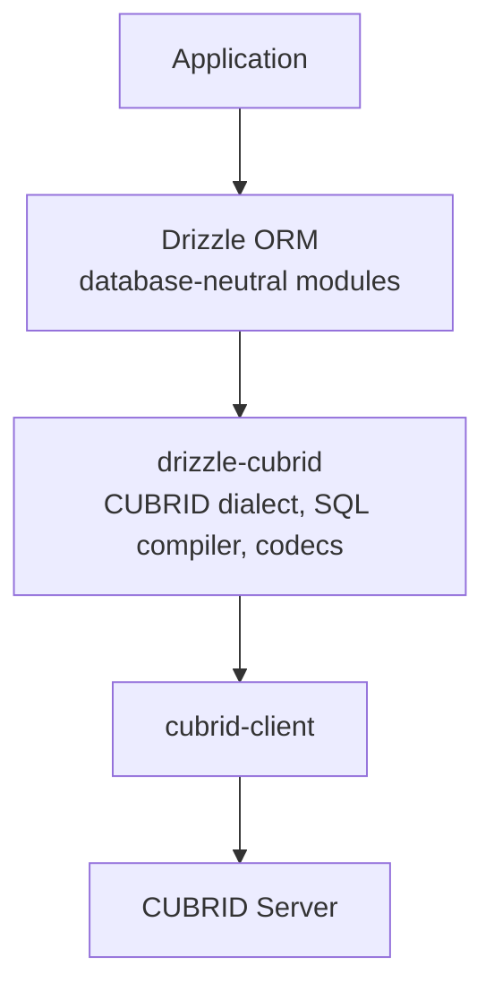

<!-- CUBRID-LAB-ICON:START -->
<p align="center">
  <a href="https://github.com/cubrid-lab/brand"></a>
</p>
<!-- CUBRID-LAB-ICON:END -->

# drizzle-cubrid

**Drizzle ORM dialect for the CUBRID database** — TypeScript-first, type-safe schema definition and query builder for Node.js.

> **Community adapter:** `drizzle-cubrid` is independently maintained by CUBRID Lab. It is not an official `drizzle-orm` dialect or a built-in Drizzle Kit integration. Drizzle Kit is not supported in any dialect; do not assume that its MySQL dialect is compatible with CUBRID. An experimental CUBRID-native migrator applies hand-written or generated CUBRID SQL files (see [Schema migrations](docs/MIGRATIONS.md), [#163](https://github.com/cubrid-lab/drizzle-cubrid/issues/163)).

> **0.3 changes the root entry.** `drizzle-cubrid` is now the CUBRID-native dialect, which until 0.2 was the `drizzle-cubrid/native` preview (still available as an alias). The 0.x API built on Drizzle's MySQL classes moved to **`drizzle-cubrid/legacy`**: it is deprecated, prints a one-time `DRIZZLE_CUBRID_LEGACY` deprecation warning, and will be removed in 1.0. See [Migrating from 0.x](docs/MIGRATING_FROM_0X.md) and [ADR 0010](docs/adr/0010-promote-native-root-deprecate-0x.md).

[🇰🇷 한국어](docs/README.ko.md) · [🇺🇸 English](README.md)

<!-- BADGES:START -->
[](https://www.npmjs.com/package/drizzle-cubrid)
[](https://nodejs.org)
[](https://github.com/cubrid-lab/drizzle-cubrid/actions/workflows/ci.yml)
[](https://github.com/cubrid-lab/drizzle-cubrid/blob/main/LICENSE)
[](https://github.com/cubrid-lab/drizzle-cubrid)
<!-- BADGES:END -->

---

## Why drizzle-cubrid?

[Drizzle ORM](https://orm.drizzle.team/) is a modern TypeScript ORM with a SQL-like query API, zero dependencies, and first-class type inference. `drizzle-cubrid` brings it to CUBRID with a dialect written for CUBRID, not adapted from another database's ([ADR 0003](docs/adr/0003-native-architecture-boundaries.md), [ADR 0007](docs/adr/0007-drizzle-extension-boundary.md)):

- **Type-safe queries** — Full TypeScript inference from schema to query results
- **Drizzle query API** — `select()` with joins, subqueries and set operations, `insert()`, `update()`, `delete()`, `$returningId()`
- **CUBRID types with codecs** — `SET`, `MULTISET`, `SEQUENCE`, `MONETARY`, `NUMERIC` as exact strings, `BIGINT` as `bigint`, `BIT` as `Buffer`
- **Transactions with savepoints** — each transaction on its own connection; nested transactions are savepoints
- **Relational queries** — `db.query.users.findMany({ with: { posts: true } })`, without `LATERAL` or JSON
- **Prepared queries and streaming** — `prepare()` on every query, `iterator()` on selects
- **Schema migrations (experimental)** — ordered CUBRID SQL files, one transaction per migration
- **Tested** — offline unit tests with a 95% coverage gate, a live CUBRID 11.4 suite and a packed-tarball live suite on every code change in CI

> **Pre-1.0:** the API can change in a minor release (with migration notes, [ADR 0001](docs/adr/0001-release-governance.md)), and production use is not yet signed off (see [docs/DESIGN_SIGNOFF.md](docs/DESIGN_SIGNOFF.md)). The migrator is experimental ([COMPATIBILITY.md](docs/COMPATIBILITY.md)).

### Architecture



**Node support policy:** The planned `drizzle-cubrid@1.x` line will support **Node 18 throughout all 1.x releases**, matching `cubrid-client@1.x`'s runtime generation without synchronizing patch/minor versions. Node 22 is used for modern development tools only. Raising the runtime minimum is a possible **2.0 MAJOR** change requiring review, never a 1.x tooling fix. See [ADR 0006](docs/adr/0006-node-18-support-through-1x.md); the packed adapter and its tested peer dependencies require independent Node 18 consumer checks.

## Installation

```bash
npm install drizzle-cubrid drizzle-orm cubrid-client
```

| Package | Purpose |
|---------|---------|
| `drizzle-cubrid` | CUBRID dialect for Drizzle (this package) |
| `drizzle-orm` | Drizzle ORM core |
| `cubrid-client` | TypeScript CUBRID driver |

**Requirements**: Node.js 18+, CUBRID 11.4 (the version tested in CI; other server versions are unverified), `drizzle-orm` `>=0.44.1 <0.46.0`, `cubrid-client` `>=1.4.0 <2.0.0` (see [peer dependency compatibility](docs/COMPATIBILITY.md) and [what is verified](docs/COMPATIBILITY.md#what-is-verified-and-what-is-not))

### Entry points

| Import | What it is |
| --- | --- |
| `drizzle-cubrid` | The CUBRID-native dialect: tables, column builders, `drizzle()`, and Drizzle's operators (`eq`, `and`, `sql`, …) |
| `drizzle-cubrid/migrator` | Experimental: `migrate()` and `readMigrationFiles()` for CUBRID SQL migrations ([MIGRATIONS.md](docs/MIGRATIONS.md)) |
| `drizzle-cubrid/native`, `drizzle-cubrid/native/migrator` | Aliases of the two above, kept through 1.x; the same modules, so the same classes |
| `drizzle-cubrid/legacy` | **Deprecated** 0.x API (MySQL-based), removed in 1.0 ([migration guide](docs/MIGRATING_FROM_0X.md)) |

## Quick Start

### 1. Define Your Schema

```ts
// schema.ts
import { cubridTable, datetime, integer, set, varchar } from "drizzle-cubrid";

export const users = cubridTable("users", {
  id: integer().primaryKey().autoIncrement(),
  name: varchar({ length: 100 }).notNull(),
  email: varchar({ length: 200 }).notNull().unique(),
  tags: set({ element: varchar({ length: 20 }) }),
  createdAt: datetime("created_at").$defaultFn(() => new Date()),
});
```

A builder called without a name uses its key as the column name. See the
[column builders](docs/NATIVE_API.md#column-builders) for every type and its
codec.

### 2. Create the Table

```ts
import { generateInitialMigration } from "drizzle-cubrid";
import * as schema from "./schema";

// Write this to migrations/0001_init.sql and apply it with migrate() (below).
console.log(generateInitialMigration(schema));
```

### 3. Connect and Query

```ts
// app.ts
import { createClient } from "cubrid-client";
import { drizzle, eq } from "drizzle-cubrid";
import { migrate } from "drizzle-cubrid/migrator";
import { users } from "./schema";

const client = createClient({
  host: "localhost",
  port: 33000,
  database: "demodb",
  user: "dba",
  // Required to read date and time columns; see "Date and time columns".
  timezone: "utc",
});

const db = drizzle(client);
await migrate(db, { migrationsFolder: "./migrations" });

// Insert, with the generated key
const [{ id }] = await db
  .insert(users)
  .values({ name: "Alice", email: "alice@example.com", tags: ["admin"] })
  .$returningId();

// Select with type-safe results
const allUsers = await db.select().from(users);
// { id: number; name: string; email: string; tags: (string | null)[] | null; createdAt: Date | null }[]

// Where clause
const alice = await db.select().from(users).where(eq(users.name, "Alice"));

// Update and delete
await db.update(users).set({ name: "Alicia" }).where(eq(users.id, id));
await db.delete(users).where(eq(users.id, id));

await client.close();
```

See the [native API reference](docs/NATIVE_API.md) for queries, writes,
relational queries, prepared queries and streaming.

## Parameters

Values are sent as typed binds by default (cubrid-client's `queryPrepared()` /
`executePrepared()`), so no value becomes part of the SQL text, and every value
goes through its column's codec first. Pass
`drizzle(client, { binding: "literal" })` to send them as escaped SQL literals.
See [Binding](docs/NATIVE_API.md#binding).

## Date and time columns

`datetime`, `timestamp`, `date` and `time` store a **UTC wall clock**: a
`Date` is written as its UTC fields and read back as the same instant.

Reading these columns needs a client that decodes in UTC. Create it with
`timezone: "utc"`, or run the process with `TZ=UTC`:

```ts
const client = createClient({ host, port, database, user, timezone: "utc" });
```

Otherwise a select of a date or time column is refused before it is sent. See
[Date and time](docs/NATIVE_API.md#date-and-time) for each mode's values and
ranges.

## CUBRID-Specific Column Types

```ts
import { cubridTable, integer, monetary, multiset, sequence, set, varchar } from "drizzle-cubrid";

export const products = cubridTable("products", {
  id: integer().primaryKey().autoIncrement(),
  name: varchar({ length: 100 }),
  tags: set({ element: varchar({ length: 50 }) }),               // SET(VARCHAR(50))
  categories: multiset({ element: varchar({ length: 50 }) }),    // MULTISET(VARCHAR(50))
  rankings: sequence({ element: integer() }),                    // SEQUENCE(INTEGER), (number | null)[]
  price: monetary(),                                             // MONETARY, read as a string
});
```

Collections are arrays in both directions; each element goes through the
element column's codec. See [Collections](docs/NATIVE_API.md#collections).

## Transactions

```ts
await db.transaction(async (tx) => {
  await tx.insert(users).values({ name: "Alice", email: "a@example.com" });

  // A nested transaction is a savepoint: its failure undoes only its own work.
  await tx
    .transaction(async (inner) => {
      await inner.insert(users).values({ name: "Bob", email: "b@example.com" });
      throw new Error("rollback inner only");
    })
    .catch(() => undefined);
}, { isolationLevel: "repeatable read" });
```

Each `db.transaction()` runs on its own connection through cubrid-client's
`transaction()`; statements of `db` outside the callback never join it.
`tx.rollback()` throws `CubridTransactionRollbackError`. CUBRID has no
`"read uncommitted"` level and no read-only transactions; both are refused.
See [Transactions](docs/NATIVE_API.md#transactions) and
[Failures](docs/NATIVE_API.md#failures).

## Relations

```ts
import { relations } from "drizzle-orm";
import { cubridTable, drizzle, integer, varchar } from "drizzle-cubrid";

export const users = cubridTable("users", {
  id: integer().primaryKey().autoIncrement(),
  name: varchar({ length: 100 }).notNull(),
});
export const posts = cubridTable("posts", {
  id: integer().primaryKey().autoIncrement(),
  title: varchar({ length: 200 }).notNull(),
  authorId: integer("author_id").notNull().references(() => users.id),
});
export const usersRelations = relations(users, ({ many }) => ({ posts: many(posts) }));
export const postsRelations = relations(posts, ({ one }) => ({
  author: one(users, { fields: [posts.authorId], references: [users.id] }),
}));

const db = drizzle(client, { schema: { users, posts, usersRelations, postsRelations } });
const withPosts = await db.query.users.findMany({ with: { posts: true }, limit: 10 });
```

Relations are loaded with one statement per level (`IN` lists of the parent
keys), not with `LATERAL` or JSON, so types such as `BIGINT` and dates keep
their codecs. See [Relational queries](docs/NATIVE_API.md#relational-queries).

## Error Handling

Errors propagate from `cubrid-client` with structured error types:

```ts
import { ConnectionError, QueryError, TransactionError } from "cubrid-client";

try {
  await db.select().from(users);
} catch (error) {
  if (error instanceof QueryError) {
    console.error("Query failed:", error.message);
    console.error("Cause:", error.cause);
  }
}
```

## CUBRID Limitations

| Feature | Status | Notes |
|---------|--------|-------|
| `INSERT ... RETURNING` | ❌ Not supported | Use `$returningId()` or `lastInsertId` ([Results](docs/NATIVE_API.md#results)) |
| Streaming inside `db.transaction()` or of relational queries | ❌ Refused | Stream a `select()` outside a transaction ([Streaming](docs/NATIVE_API.md#streaming)) |
| Schema diffing, `ALTER` generation, reflection, Drizzle Kit | ❌ Not provided | `migrate()` applies CUBRID SQL files; `generateInitialMigration()` writes the first one; later changes are hand-written ([details](docs/MIGRATIONS.md), [#163](https://github.com/cubrid-lab/drizzle-cubrid/issues/163)) |
| JSON, BLOB, CLOB, ENUM, zone-aware date types | ❌ No builder | See [Not supported](docs/NATIVE_API.md#not-supported-in-the-native-dialect) |
| Native BOOLEAN | ❌ Not in CUBRID | `boolean()` is `SMALLINT` 1/0 |
| FULL JOIN, LATERAL, `for('share')` | ❌ Not in CUBRID | Refused before sending ([Errors and refusals](docs/NATIVE_API.md#errors-and-refusals)) |
| CUBRID versions other than 11.4 | ⚠️ Unverified | Only 11.4 runs in CI ([#164](https://github.com/cubrid-lab/drizzle-cubrid/issues/164)) |

## Documentation

| Document | Description |
|----------|-------------|
| [Native API](docs/NATIVE_API.md) | Tables, column builders, codecs, queries, writes, transactions, relational queries, prepared queries and streaming |
| [Schema migrations](docs/MIGRATIONS.md) | Experimental CUBRID-native migrator: file format, refusals, recovery, what is not implemented |
| [Migrating from 0.x](docs/MIGRATING_FROM_0X.md) | From the deprecated MySQL-based API (`drizzle-cubrid/legacy`) to the native one |
| [Compatibility](docs/COMPATIBILITY.md) | Peer ranges and what is verified |
| [Troubleshooting](docs/TROUBLESHOOTING.md) | Common errors, TypeScript issues, performance tips |
| [0.x schema guide](docs/SCHEMA.md), [0.x queries guide](docs/QUERIES.md) | The deprecated `drizzle-cubrid/legacy` API, until it is removed in 1.0 |

## Development

### Reproducible contributor setup

Use the [development setup guide](docs/DEVELOPMENT_SETUP.md) for the actual language-specific toolchain, clean dependency install, offline tests, **real CUBRID integration readiness** and known setup blockers. The [ADR index](docs/adr/README.md) records proposed release, architecture, TDD and setup decisions. Documentation alone is not a claim that those tests have run or that an unverified runtime/database version is supported.


```bash
git clone https://github.com/cubrid-lab/drizzle-cubrid.git
cd drizzle-cubrid
npm install
npm run build        # TypeScript compilation
npm run lint         # Biome lint + format check
npm run typecheck    # tsc --noEmit
npm test             # Run tests
```

## Ecosystem

| Package | Description |
|---------|-------------|
| [cubrid-client](https://github.com/cubrid-lab/cubrid-client) | TypeScript CUBRID driver |
| [drizzle-cubrid](https://github.com/cubrid-lab/drizzle-cubrid) | Drizzle ORM dialect (this package) |

## Roadmap

See [`ROADMAP.md`](ROADMAP.md) for this project's direction and next milestones.


## Disclaimer

This project is part of [CUBRID Lab](https://github.com/cubrid-lab), an independent open-source initiative for CUBRID developer tooling, and is not affiliated with, sponsored by, or endorsed by CUBRID Corporation or the official CUBRID project.

## License

MIT — see [LICENSE](LICENSE). Parts of two files of the deprecated 0.x API (`drizzle-cubrid/legacy`) follow drizzle-orm code (Apache-2.0); see [THIRD_PARTY_NOTICES.md](THIRD_PARTY_NOTICES.md) and [docs/PROVENANCE.md](docs/PROVENANCE.md).
