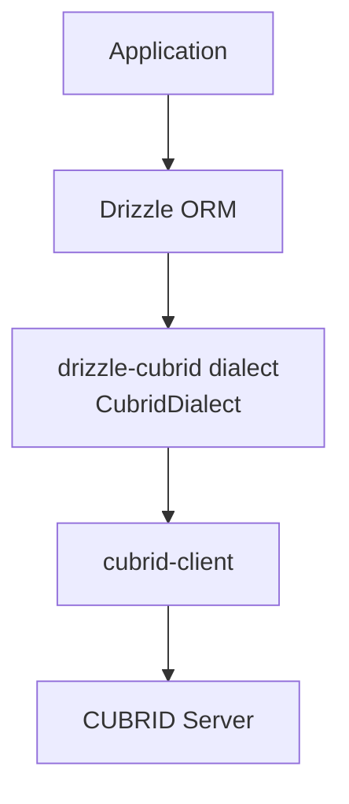

<!-- CUBRID-LAB-ICON:START -->
<p align="center">
  <a href="https://github.com/cubrid-lab/brand"></a>
</p>
<!-- CUBRID-LAB-ICON:END -->

# drizzle-cubrid

**Drizzle ORM dialect for the CUBRID database** — TypeScript-first, type-safe schema definition and query builder for Node.js.

> **Community adapter:** `drizzle-cubrid` is independently maintained by CUBRID Lab. It is not an official `drizzle-orm` dialect or a built-in Drizzle Kit integration. CUBRID-native schema migration support is under design; do not assume that Drizzle Kit's MySQL dialect is compatible with CUBRID. See [migration design tracking](https://github.com/cubrid-lab/drizzle-cubrid/issues/163) and [native dialect design](https://github.com/cubrid-lab/drizzle-cubrid/issues/155).

[🇰🇷 한국어](docs/README.ko.md) · [🇺🇸 English](README.md)

<!-- BADGES:START -->
[](https://www.npmjs.com/package/drizzle-cubrid)
[](https://nodejs.org)
[](https://github.com/cubrid-lab/drizzle-cubrid/actions/workflows/ci.yml)
[](https://codecov.io/gh/cubrid-lab/drizzle-cubrid)
[](https://github.com/cubrid-lab/drizzle-cubrid/blob/main/LICENSE)
[](https://github.com/cubrid-lab/drizzle-cubrid)
<!-- BADGES:END -->

---

## Why drizzle-cubrid?

[Drizzle ORM](https://orm.drizzle.team/) is a modern TypeScript ORM with a SQL-like query API, zero dependencies, and first-class type inference. Until now, there was no Drizzle dialect for CUBRID.

`drizzle-cubrid` bridges that gap:

- **Type-safe queries** — Full TypeScript inference from schema to query results
- **Drizzle query API** — `select()`, `insert()`, `update()`, `delete()` with the familiar Drizzle chain syntax
- **CUBRID-specific types** — `SET`, `MULTISET`, `SEQUENCE`, `MONETARY` as native column builders
- **Transactions with savepoints** — Nested transaction support via CUBRID savepoints
- **Relational queries** — `db.query.users.findMany()` / `findFirst()` with `where`, `columns`, `orderBy` and `limit`; loading relations with `with` is not supported yet (#200)
- **Tested** — offline unit tests with a 95% coverage gate, plus a live CUBRID 11.4 suite on every code change in CI

### Architecture



**Node support policy:** The planned `drizzle-cubrid@1.x` line will support **Node 18 throughout all 1.x releases**, matching `cubrid-client@1.x`'s runtime generation without synchronizing patch/minor versions. Node 22 is used for modern development tools only. Raising the runtime minimum is a possible **2.0 MAJOR** change requiring review, never a 1.x tooling fix. See [ADR 0006](docs/adr/0006-node-18-support-through-1x.md); the packed adapter and its tested peer dependencies require independent Node 18 consumer checks.

## Installation

```bash
npm install drizzle-cubrid drizzle-orm cubrid-client
```

| Package | Purpose |
|---------|---------|
| `drizzle-cubrid` | CUBRID dialect for Drizzle (this package) |
| `drizzle-orm` | Drizzle ORM core |
| `cubrid-client` | TypeScript CUBRID driver |

**Requirements**: Node.js 18+, CUBRID 11.4 (the version tested in CI; other server versions are unverified), `drizzle-orm` `>=0.44.1 <0.46.0`, `cubrid-client` `>=1.4.0 <2.0.0` (see [peer dependency compatibility](docs/COMPATIBILITY.md))

## Quick Start

### 1. Define Your Schema

```ts
// schema.ts
import { cubridTable, int, varchar, timestamp } from "drizzle-cubrid";

export const users = cubridTable("users", {
  id: int("id").primaryKey().autoincrement(),
  name: varchar("name", { length: 100 }).notNull(),
  email: varchar("email", { length: 200 }).notNull().unique(),
  created_at: timestamp("created_at").defaultNow(),
});
```

### 2. Connect and Query

```ts
// app.ts
import { createClient } from "cubrid-client";
import { drizzle } from "drizzle-cubrid";
import { eq } from "drizzle-cubrid";
import { users } from "./schema";

const client = createClient({
  host: "localhost",
  port: 33000,
  database: "demodb",
  user: "dba",
});

const db = drizzle(client);

// Insert
await db.insert(users).values({
  name: "Alice",
  email: "alice@example.com",
});

// Select with type-safe results
const allUsers = await db.select().from(users);
// allUsers: { id: number; name: string; email: string; created_at: Date | null }[]

// Where clause
const alice = await db
  .select()
  .from(users)
  .where(eq(users.name, "Alice"));

// Update
await db
  .update(users)
  .set({ name: "Alicia" })
  .where(eq(users.id, 1));

// Delete
await db.delete(users).where(eq(users.id, 1));

// Close connection
await client.close();
```

## Parameters

Values are sent as typed binds by default (cubrid-client's `queryPrepared()` /
`executePrepared()`), so no value becomes part of the SQL text. Pass
`drizzle(client, { binding: "literal" })` to send them as escaped SQL literals,
one round trip fewer per statement. See
[how values reach the server](docs/QUERIES.md#how-values-reach-the-server).

## CUBRID-Specific Column Types

Beyond standard SQL types, CUBRID has collection types and a monetary type:

```ts
import { cubridTable, int, varchar } from "drizzle-cubrid";
import { cubridSet, cubridMultiset, cubridSequence, monetary } from "drizzle-cubrid";

export const products = cubridTable("products", {
  id: int("id").primaryKey().autoincrement(),
  name: varchar("name", { length: 100 }),

  // SET — unordered unique values → SET(VARCHAR(50))
  tags: cubridSet("tags", { element: varchar("tag_item", { length: 50 }) }),

  // MULTISET — unordered, allows duplicates → MULTISET(VARCHAR(50))
  categories: cubridMultiset("categories", { element: varchar("category_item", { length: 50 }) }),

  // SEQUENCE — ordered, allows duplicates → SEQUENCE(INTEGER), number[]
  rankings: cubridSequence<number>("rankings", { element: int("rank_item") }),

  // MONETARY — CUBRID native monetary type → MONETARY
  price: monetary("price"),
});
```

```ts
// Insert with collection values
await db.insert(products).values({
  name: "Widget",
  tags: ["sale", "new"],           // string[] → SET
  categories: ["electronics"],     // string[] → MULTISET
  rankings: [1, 3, 5],             // number[] → SEQUENCE
});

// Select — collections return arrays; elements keep their JavaScript types
const rows = await db.select().from(products);
console.log(rows[0].tags); // ["sale", "new"]
```

## Transactions

### Automatic (Recommended)

```ts
await db.transaction(async (tx) => {
  await tx.insert(users).values({ name: "Alice", email: "a@example.com" });
  await tx.insert(users).values({ name: "Bob", email: "b@example.com" });
  // Auto-committed on success, auto-rolled back on error
});
```

Each `db.transaction()` runs on its own connection, taken through
`cubrid-client`'s `transaction(callback, options)` on a `CubridClient` or a
`CubridPool`. Queries made through `db` outside the callback, including from
concurrent requests, never join, commit or roll back that transaction. The
error the callback throws (including the `TransactionRollbackError` from
`tx.rollback()`) is rethrown as the same object. The driver's own error is
added to it as `error.transactionError`, and a failed rollback also as
`error.rollbackError`.

`isolationLevel` accepts `"read committed"`, `"repeatable read"` and
`"serializable"`, and needs cubrid-client 1.3.0 or later (`createPool()` needs
1.4.0). CUBRID has no `"read uncommitted"` level, read-only mode or
consistent-snapshot start, so `accessMode`, `withConsistentSnapshot` and
`"read uncommitted"` are rejected before the transaction starts:

```ts
await db.transaction(async (tx) => {
  // ...
}, { isolationLevel: "serializable" });
```

A custom client object passed to `drizzle()` must return each row as an array
of its values in select-list order from `query(sql, params, { rowMode: "array" })`,
as cubrid-client 1.4.0 does; selects that map fields refuse object rows, because
a column label shared by two tables keeps only one value in an object. A custom
client with a `transaction(callback, options?)` method must
run `callback` with a client for the transaction's connection, commit when it
resolves and roll back when it rejects. One without `transaction()` falls back
to `BEGIN`/`COMMIT` on its single connection, which is only safe if nothing
else uses that connection at the same time.

### Nested Transactions (Savepoints)

```ts
await db.transaction(async (tx) => {
  await tx.insert(users).values({ name: "Alice", email: "a@example.com" });

  try {
    await tx.transaction(async (tx2) => {
      // SAVEPOINT sp1
      await tx2.insert(users).values({ name: "Bob", email: "b@example.com" });
      throw new Error("rollback inner only");
      // ROLLBACK TO SAVEPOINT sp1
    });
  } catch {
    // Inner rolled back, outer continues
  }

  await tx.insert(users).values({ name: "Charlie", email: "c@example.com" });
  // Alice + Charlie committed, Bob rolled back
});
```

## Relations

```ts
import { cubridTable, int, varchar } from "drizzle-cubrid";
import { relations } from "drizzle-orm";

export const users = cubridTable("users", {
  id: int("id").primaryKey().autoincrement(),
  name: varchar("name", { length: 100 }).notNull(),
});

export const posts = cubridTable("posts", {
  id: int("id").primaryKey().autoincrement(),
  title: varchar("title", { length: 200 }).notNull(),
  author_id: int("author_id").notNull(),
});

export const usersRelations = relations(users, ({ many }) => ({
  posts: many(posts),
}));

export const postsRelations = relations(posts, ({ one }) => ({
  author: one(users, {
    fields: [posts.author_id],
    references: [users.id],
  }),
}));
```

```ts
import { eq } from "drizzle-cubrid";
import * as schema from "./schema";
import { posts, users } from "./schema";

const db = drizzle(client, { schema, mode: "default" });

const alice = await db.query.users.findFirst({ where: eq(users.id, 1) });
const alicesPosts = await db.select().from(posts).where(eq(posts.author_id, 1));
```

Loading relations with `with` is not supported on CUBRID yet and throws:
Drizzle's MySQL SQL for it uses `LEFT JOIN LATERAL` (`mode: "default"`), which
CUBRID lacks, or JSON aggregation (`mode: "planetscale"`), which CUBRID rejects
for DATE/DATETIME values and which garbles non-ASCII text in an ISO-8859-1
database; Drizzle also reads that JSON with `JSON.parse`, which rounds BIGINT
values beyond 2^53
([#200](https://github.com/cubrid-lab/drizzle-cubrid/issues/200)). Query the
related table separately or use a join; native support is tracked in
[#158](https://github.com/cubrid-lab/drizzle-cubrid/issues/158).

## Error Handling

Errors propagate from `cubrid-client` with structured error types:

```ts
import { ConnectionError, QueryError, TransactionError } from "cubrid-client";

try {
  await db.select().from(users);
} catch (error) {
  if (error instanceof QueryError) {
    console.error("Query failed:", error.message);
    console.error("Cause:", error.cause);
  }
}
```

## CUBRID Limitations

| Feature | Status | Notes |
|---------|--------|-------|
| `INSERT ... RETURNING` | ❌ Not supported | Use separate SELECT after INSERT |
| Streaming / iterators | ❌ Not supported | Use LIMIT/OFFSET for pagination |
| JSON columns | ❌ Not supported | Use VARCHAR with manual serialization |
| Native BOOLEAN | ❌ Not supported | Mapped to SMALLINT (0/1) |
| Sequences | ❌ Not supported | Use AUTO_INCREMENT |

## Documentation

| Document | Description |
|----------|-------------|
| [Schema Guide](docs/SCHEMA.md) | Column types, CUBRID types, relations, custom types |
| [Queries Guide](docs/QUERIES.md) | SELECT, INSERT, UPDATE, DELETE, joins, aggregations, raw SQL |
| [Troubleshooting](docs/TROUBLESHOOTING.md) | Common errors, TypeScript issues, performance tips |
| [Schema migration status](examples/migration/README.md) | Native CUBRID migration is not yet supported; no other database dialect fallback |

## Development

### Reproducible contributor setup

Use the [development setup guide](docs/DEVELOPMENT_SETUP.md) for the actual language-specific toolchain, clean dependency install, offline tests, **real CUBRID integration readiness** and known setup blockers. The [ADR index](docs/adr/README.md) records proposed release, architecture, TDD and setup decisions. Documentation alone is not a claim that those tests have run or that an unverified runtime/database version is supported.


```bash
git clone https://github.com/cubrid-lab/drizzle-cubrid.git
cd drizzle-cubrid
npm install
npm run build        # TypeScript compilation
npm run check        # Lint + type-check + test
npm test             # Run tests
```

## Ecosystem

| Package | Description |
|---------|-------------|
| [cubrid-client](https://github.com/cubrid-lab/cubrid-client) | TypeScript CUBRID driver |
| [drizzle-cubrid](https://github.com/cubrid-lab/drizzle-cubrid) | Drizzle ORM dialect (this package) |

## Roadmap

See [`ROADMAP.md`](ROADMAP.md) for this project's direction and next milestones.


## Disclaimer

This project is part of [CUBRID Lab](https://github.com/cubrid-lab), an independent open-source initiative for CUBRID developer tooling, and is not affiliated with, sponsored by, or endorsed by CUBRID Corporation or the official CUBRID project.

## License

MIT — see [LICENSE](LICENSE).
