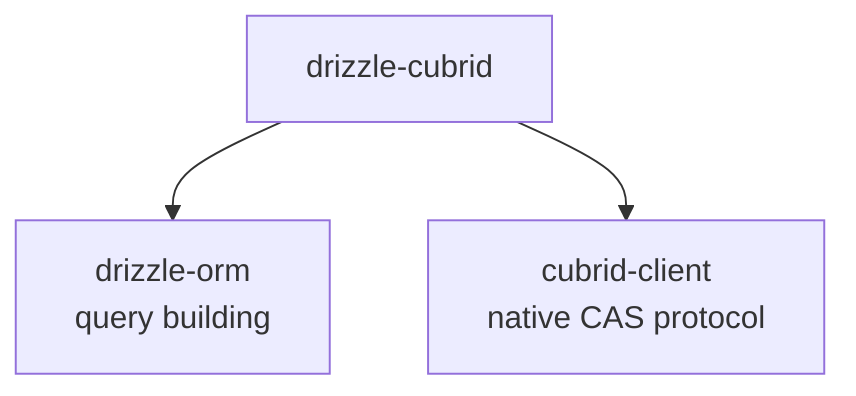

# Troubleshooting

Solutions for common issues when using `drizzle-cubrid`.

## Installation Issues

### Peer dependency warnings

```
npm warn peer drizzle-orm@">=0.44.1 <0.46.0" from drizzle-cubrid
```

Installing a version outside the supported ranges directly fails with
`npm error code ERESOLVE` instead. Install all required peer dependencies within
the supported ranges (see [peer dependency compatibility](COMPATIBILITY.md)):

```bash
npm install drizzle-cubrid drizzle-orm cubrid-client
```

The dependency chain is:



### `Cannot find module 'drizzle-cubrid'`

Ensure your `tsconfig.json` has proper module resolution:

```json
{
  "compilerOptions": {
    "module": "ESNext",
    "moduleResolution": "bundler",
    "esModuleInterop": true
  }
}
```

## Connection Issues

### `Failed to connect to CUBRID`

The CUBRID broker must be running and accessible:

```bash
# Check if CUBRID is running
docker ps | grep cubrid

# Start a disposable CUBRID with Docker
docker run -d --name cubrid-test -e CUBRID_DB=testdb -p 33000:33000 cubrid/cubrid:11.4
```

Connection config:

```ts
const client = createClient({
  host: "localhost",   // or container hostname
  port: 33000,         // CUBRID broker port (NOT the database port)
  database: "testdb",  // must exist
  user: "dba",
  password: "",
});
```

### `drizzle()` throws "Invalid drizzle() call"

You must pass a `cubrid-client` instance, not a config object:

```ts
// ❌ Wrong — passing config directly
const db = drizzle({
  host: "localhost",
  database: "demodb",
  user: "dba",
});

// ✅ Correct — pass client instance
const client = createClient({
  host: "localhost",
  database: "demodb",
  user: "dba",
});
const db = drizzle(client);

// ✅ Also correct — client in config
const db2 = drizzle({ client });
```

## Schema Issues

### `cubridTable is not a function`

Make sure you import from `drizzle-cubrid`, not from `drizzle-orm/mysql-core`:

```ts
// ✅ Correct
import { cubridTable, int, varchar } from "drizzle-cubrid";

// ⚠️ Also works (cubridTable is an alias for mysqlTable)
import { mysqlTable } from "drizzle-orm/mysql-core";
```

### CUBRID-specific types not available

Import collection types directly from `drizzle-cubrid`:

```ts
import { set, multiset, sequence, monetary } from "drizzle-cubrid";
```

These are custom types — they won't be available from `drizzle-orm`.

### Collection type format errors

Collection types use `{val1,val2}` format internally:

```ts
// ✅ Correct — pass array, drizzle handles serialization
await db.insert(table).values({ tags: ["a", "b", "c"] });

// ❌ Wrong — don't pass raw string format
await db.insert(table).values({ tags: "{a,b,c}" as any });
```

## Query Issues

### DDL/DML returns empty result

This is expected. INSERT, UPDATE, DELETE, CREATE, DROP, etc. return `[]`:

```ts
const result = await db.insert(users).values({ name: "Alice", email: "a@example.com" });
// result is [] — this is correct for CUBRID
```

### `Streaming is not supported by the CUBRID driver`

CUBRID doesn't support server-side cursors. Use `LIMIT`/`OFFSET` for pagination:

```ts
// ❌ Won't work
const iterator = await prepared.iterator();

// ✅ Use pagination instead
const page1 = await db.select().from(users).limit(10).offset(0);
const page2 = await db.select().from(users).limit(10).offset(10);
```

### `drizzle-cubrid reads DATETIME, TIMESTAMP, DATE and TIME columns as a UTC wall clock, but this client decodes them in the process's local time zone`

The query selects a `datetime`, `timestamp`, `date` or `time` column (or a
collection of them), and the client decodes those values in a time zone other
than UTC. drizzle-cubrid stores the wall clock as UTC, so the values would be
shifted by the zone's offset. Create the client with `timezone: "utc"`:

```ts
const client = createClient({ host, port, database, user, timezone: "utc" });
```

or run the process with `TZ=UTC`. See
[Date and time columns](SCHEMA.md#date-and-time-columns).

### `TIMESTAMP column ... stores whole seconds`

CUBRID's TIMESTAMP has no milliseconds and drops them without an error, so a
`Date` with milliseconds is refused. Round it (`new Date(Math.floor(d.getTime() / 1000) * 1000)`)
or use a `datetime()` column.

### Column names are lowercase

CUBRID folds unquoted identifiers to lowercase. Your result objects will have lowercase keys regardless of how you wrote the SQL:

```ts
const rows = await db.select({ Name: users.name }).from(users);
// Access as rows[0].Name — Drizzle uses your defined column alias
```

### `RETURNING` not supported

CUBRID doesn't support `INSERT ... RETURNING`. If you need the inserted row, query it separately:

```ts
await db.insert(users).values({ name: "Alice", email: "a@example.com" });

// Fetch the inserted row
const [alice] = await db
  .select()
  .from(users)
  .where(eq(users.email, "a@example.com"));
```

## Transaction Issues

### Transaction not committing

Ensure you're using the `tx` parameter inside the callback, not the outer `db`:

```ts
// ❌ Wrong — operations run outside the transaction
await db.transaction(async (tx) => {
  await db.insert(users).values({ name: "Alice", email: "a@example.com" }); // Uses db, not tx!
});

// ✅ Correct — use tx for all operations
await db.transaction(async (tx) => {
  await tx.insert(users).values({ name: "Alice", email: "a@example.com" }); // Uses tx
});
```

### Savepoint names

Nested transactions use savepoints named `sp1`, `sp2`, etc. These are managed automatically — you don't need to name them:

```ts
await db.transaction(async (tx) => {
  // Outer transaction
  await tx.transaction(async (tx2) => {
    // Creates SAVEPOINT sp1
    await tx2.transaction(async (tx3) => {
      // Creates SAVEPOINT sp2
    });
  });
});
```

## Relations Issues

### `Cannot read properties of undefined (reading 'findMany')`

You must pass `schema` and `mode` to `drizzle()` to use relational queries:

```ts
import * as schema from "./schema";

// ❌ Wrong — no schema, relational queries won't work
const db = drizzle(client);

// ✅ Correct — pass schema and mode
const db = drizzle(client, { schema, mode: "default" });

// Now relational queries work
const firstUsers = await db.query.users.findMany({ limit: 10 });
```

### `Relational queries with 'with' (...) are not supported on CUBRID`

Loading relations with `with` is not supported on CUBRID yet and throws:
Drizzle's MySQL SQL for it uses `LEFT JOIN LATERAL` (`mode: "default"`), which
CUBRID lacks, or JSON aggregation (`mode: "planetscale"`), which CUBRID rejects
for DATE/DATETIME values and which garbles non-ASCII text in an ISO-8859-1
database; Drizzle also reads that JSON with `JSON.parse`, which rounds BIGINT
values beyond 2^53
([#200](https://github.com/cubrid-lab/drizzle-cubrid/issues/200)). Query the
related table separately or use a join; native support is tracked in
[#158](https://github.com/cubrid-lab/drizzle-cubrid/issues/158).

### Relations not showing up in `db.query`

Make sure you export the `relations()` definitions alongside your tables:

```ts
// schema.ts
export const users = cubridTable("users", { ... });
export const posts = cubridTable("posts", { ... });

// These MUST be exported too
export const usersRelations = relations(users, ({ many }) => ({
  posts: many(posts),
}));

export const postsRelations = relations(posts, ({ one }) => ({
  author: one(users, {
    fields: [posts.author_id],
    references: [users.id],
  }),
}));
```

## TypeScript Issues

### Type mismatch with `bigint` mode

The `bigint` column requires a `mode` option:

```ts
// Returns JavaScript number
bigint("col", { mode: "number" })

// Returns JavaScript bigint
bigint("col", { mode: "bigint" })
```

### Custom type inference

For CUBRID-specific types, the inferred TypeScript types are:

| Column | TypeScript Type |
|--------|----------------|
| `set<T>(...)` | `(T \| null)[]`, `T` = `string` by default ([details](SCHEMA.md#collection-type-configuration)) |
| `multiset<T>(...)` | `(T \| null)[]` |
| `sequence<T>(...)` | `(T \| null)[]` |
| `monetary(...)` | `string` |

## Performance Tips

### Reuse the Drizzle instance

Create `drizzle()` once and reuse:

```ts
// db.ts
import { createClient } from "cubrid-client";
import { drizzle } from "drizzle-cubrid";

const client = createClient({
  host: "localhost",
  database: "myapp",
  user: "dba",
});

export const db = drizzle(client);
```

### Reuse a built query

`.prepare()` builds the SQL once on the Drizzle side. With the default typed
binding, each `execute()` still prepares and releases its own statement on the
server, so this saves the query building, not a server round trip.

```ts
import { placeholder } from "drizzle-cubrid";

const getUserById = db
  .select()
  .from(users)
  .where(eq(users.id, placeholder("id")))
  .prepare();

// Reuse across requests
const user = await getUserById.execute({ id: req.params.id });
```

### Select only needed columns

```ts
// ❌ Fetches all columns
const users = await db.select().from(users);

// ✅ Fetches only what you need
const names = await db.select({ name: users.name }).from(users);
```

## Getting Help

- [GitHub Issues](https://github.com/cubrid-labs/drizzle-cubrid/issues) — Bug reports and feature requests
- [Schema Guide](./SCHEMA.md) — Column types and table definitions
- [Queries Guide](./QUERIES.md) — Full query examples
- [Drizzle ORM Docs](https://orm.drizzle.team/) — General Drizzle ORM documentation
- [CUBRID Manual](https://www.cubrid.org/manual/) — CUBRID SQL reference
